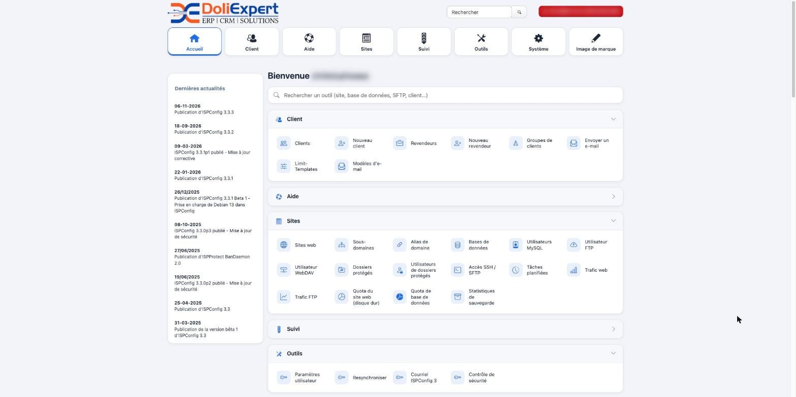
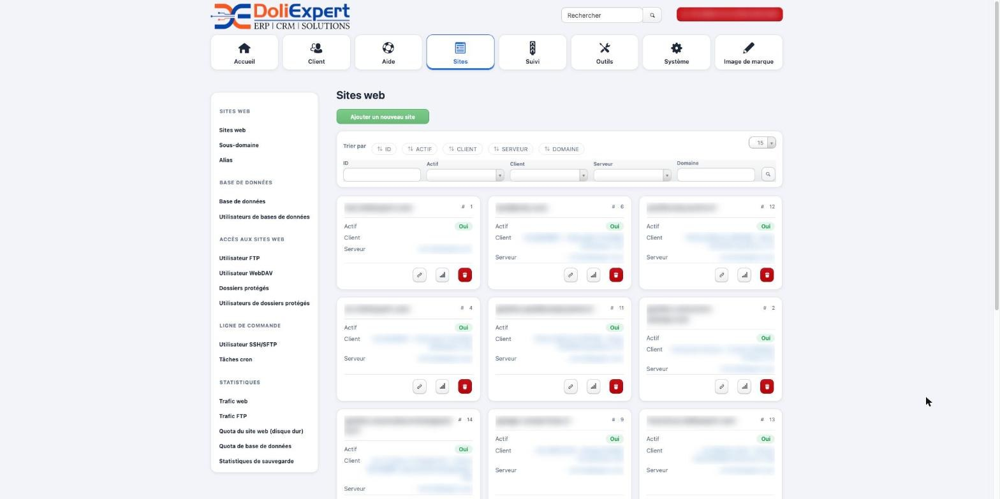
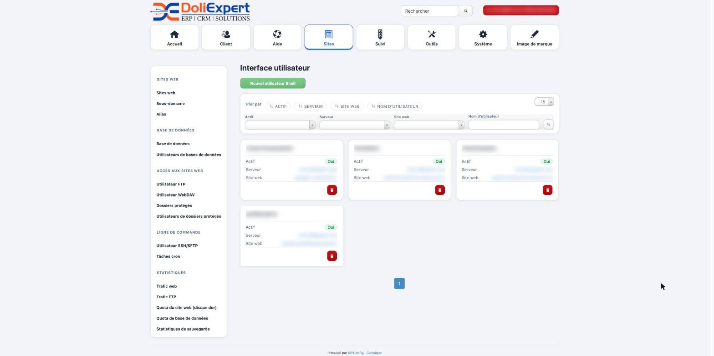

# ISPConfig Card UI

**Français** · [English](#english)

Un habillage moderne pour le panneau **ISPConfig 3.3**. Les listes deviennent des cartes arrondies, l'accueil affiche les outils par catégorie avec une recherche, et le menu principal reste en haut.

Il s'installe par-dessus le design **classic** de [ispconfig-theme-customizer](https://github.com/wadejbeckett/ispconfig-theme-customizer). Aucun fichier du cœur d'ISPConfig n'est modifié.

Développé par [DOLIEXPERT](https://www.doliexpert.com), intégrateur Dolibarr et hébergeur, pour son propre panel.

| Accueil : outils par catégorie | Liste des sites en cartes |
|---|---|
|  |  |

| Comptes SSH / SFTP |
|---|
|  |

*Captures prises sur un panel en production. Les noms de clients, domaines et identifiants sont floutés.*

## Ce que ça change

- **Listes en cartes** (sites, sous-domaines, bases de données, utilisateurs SFTP, cron, clients…). Le champ le plus parlant devient le titre de la carte : domaine, nom d'utilisateur, nom de la base ou nom de l'entreprise selon la liste. L'ID passe dans un coin, l'état « Actif » devient une pastille et les boutons d'action vont en pied de carte.
- **Tri et filtres conservés.** Les intitulés de colonnes deviennent des puces « Trier par », et les filtres restent au-dessus des cartes avec leur libellé.
- **Accueil façon « outils par catégorie ».** Un bloc par module (Client, Sites, Outils, Système…) avec une tuile par fonction et une recherche instantanée (touche Entrée = ouvrir le premier résultat). Les catégories se replient, et l'état est mémorisé.
- **Respect des droits.** Les tuiles sont lues dans les vrais menus de l'utilisateur connecté, donc un client ne voit que ce à quoi il a accès.
- **Formulaires, onglets, menu latéral et boutons** arrondis et aérés. La couleur d'accent suit celle réglée dans la page *Branding* de ispconfig-theme-customizer.
- **Logo d'en-tête** ramené à une hauteur classique (56 px, réglable).

Le JavaScript ne modifie aucune donnée : il réorganise l'affichage. Sans lui, le panel reste utilisable avec les tableaux d'origine.

## Prérequis

- ISPConfig **3.3.x**. Testé sur 3.3.3p2, Debian 13, Apache.
- [ispconfig-theme-customizer](https://github.com/wadejbeckett/ispconfig-theme-customizer) installé en design **classic**, cloné dans `/opt/ispconfig-theme-customizer`, installé avec `--copy`.
- Un accès root au serveur qui sert l'interface (le maître, en multiserveur) et PHP CLI.

## Installation

```bash
# en root, sur le serveur du panel
git clone https://github.com/DOLIEXPERT/ispconfig-card-ui.git /root/ispconfig-card-ui
bash /root/ispconfig-card-ui/install-doliexpert-ui.sh
```

Puis, dans le panel : *Outils → Paramètres utilisateur → Conception (Design) → classic*, et rechargez avec Ctrl+Shift+R (Cmd+Shift+R sur Mac).

Le script :
1. copie `doliexpert.css` et `doliexpert.js` dans `themes/classic/doliexpert/` du clone ;
2. ajoute deux crochets balisés (`DOLIEXPERT-HOOK`) dans `themes/classic/brand.php` (feuille de style) et `title.php` (script). Ce sont les deux fichiers que classic charge déjà sur chaque page ;
3. vérifie la syntaxe PHP, puis relance `install.sh --copy --design=classic --theme`.

Il est **idempotent** : relancez-le autant de fois que nécessaire, après une modification du CSS par exemple. Si le clone est ailleurs : `CLONE=/chemin/du/clone bash install-doliexpert-ui.sh`.

## Désinstallation

```bash
bash /root/ispconfig-card-ui/install-doliexpert-ui.sh --remove
```

Retire les crochets (les fichiers retrouvent leur état d'origine, à l'octet près), supprime le dossier `doliexpert/` et réinstalle classic.

## Après une mise à jour

- **Mise à jour d'ISPConfig** : relancez `./install.sh --copy --design=classic` dans le clone de ispconfig-theme-customizer, puis `install-doliexpert-ui.sh`.
- **Mise à jour de ispconfig-theme-customizer** (`git pull` dans son clone) : faites d'abord `install-doliexpert-ui.sh --remove`, sinon le pull entre en conflit avec les deux fichiers patchés. Faites ensuite le pull, puis relancez l'installation.

## Personnalisation

En tête de `doliexpert.css` :

```css
:root { --dx-accent: #1f6feb; --dx-radius: 14px; /* … */ }
:root { --dx-logo-h: 56px; --dx-logo-w: 310px; }
```

`--dx-accent` est écrasé automatiquement par la couleur d'accent de la page *Branding*, si elle est définie. Dans `doliexpert.js`, `RELABEL` permet de renommer une tuile et `DEFAULT_COLLAPSED` de choisir les catégories repliées par défaut.

## Bon à savoir

- Au premier passage sur l'accueil, le script lit le menu de chaque module (une à deux secondes). Le résultat est gardé 30 minutes, par onglet et par utilisateur.
- Pour lire ces menus, il passe brièvement par chaque module côté serveur (`capp.php`), comme le fait la navigation d'ISPConfig, puis revient sur l'accueil.
- Un filtre de liste déroulante (« Client », « Serveur »…) se remet à zéro avec la petite croix **×** dans le champ. L'option vide n'apparaît pas dans la liste : c'est le comportement d'origine d'ISPConfig.

## Licence

[MIT](LICENSE) © 2026 DOLIEXPERT. Ce projet ne contient aucun code d'ISPConfig ni de ispconfig-theme-customizer (MIT, © Wade Beckett) : il s'appuie dessus. Les icônes viennent de [Bootstrap Icons](https://icons.getbootstrap.com/) (MIT), déjà fourni par ISPConfig.

Non affilié au projet ISPConfig.

---

<a id="english"></a>

## English

A modern skin for the **ISPConfig 3.3** control panel. Lists become rounded cards, the dashboard shows tools grouped by category with a search box, and the main menu stays on top.

It sits on top of the **classic** design of [ispconfig-theme-customizer](https://github.com/wadejbeckett/ispconfig-theme-customizer) and modifies no ISPConfig core file. The UI labels added by the script are in French, and the lists and menus keep the panel's own language.

**Features.**
- Card lists. The most meaningful column becomes the card title, the ID moves to a corner, "Active" becomes a badge and the actions go to the card footer.
- Sort chips and labelled filters.
- A dashboard with categorised tool tiles and instant search, read from the logged-in user's real menus, so permissions are respected.
- Restyled forms, tabs, sidebar and buttons. The accent colour follows the *Branding* page.
- A header logo capped at a standard height.

**Requirements.** ISPConfig 3.3.x (tested on 3.3.3p2, Debian 13, Apache), with ispconfig-theme-customizer installed as `classic`, cloned in `/opt/ispconfig-theme-customizer` with `--copy`, plus root access and PHP CLI.

**Install.**
```bash
git clone https://github.com/DOLIEXPERT/ispconfig-card-ui.git /root/ispconfig-card-ui
bash /root/ispconfig-card-ui/install-doliexpert-ui.sh          # install / update (idempotent)
bash /root/ispconfig-card-ui/install-doliexpert-ui.sh --remove # uninstall, byte-exact restore
```
Then select the *classic* design in *Tools → User Settings* and hard-refresh.

**After upgrades.** After an ISPConfig upgrade, re-run the customizer's `install.sh --copy --design=classic`, then this script. Before a `git pull` of the customizer, run `--remove` first.

**License.** [MIT](LICENSE) © 2026 DOLIEXPERT. Not affiliated with the ISPConfig project.
